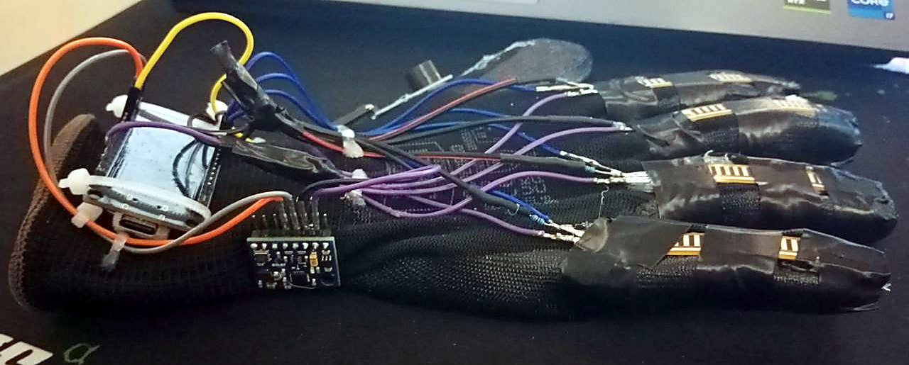
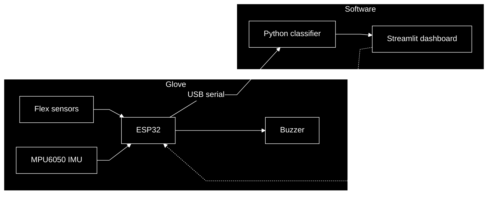

# ESP32 Gesture Recognition Glove

**A wearable gesture-recognition prototype built with ESP32, flex sensors, and machine learning.**

The glove measures finger bending and hand motion, streams measurements over USB, and identifies trained hand postures in a Streamlit dashboard. A passive buzzer provides feedback when a new gesture is recognized.



*Team 2 · Senior Design Project · Physical prototype. Photo cropped and adjusted for clarity.*

## At a glance

| Layer | Implementation |
| :--- | :--- |
| Hardware | ESP32 30-pin Type-C board, four active flex sensors, GY-87 / MPU6050, passive buzzer |
| Firmware | C++ / Arduino framework, built with PlatformIO |
| Communication | USB serial · 115200 baud · JSON per line · approximately 10 Hz |
| Recognition | Python, engineered sensor features, Random Forest classifier |
| Interface | Streamlit dashboard with telemetry, class probabilities, and gesture history |
| Demo vocabulary | Open hand, closed fist, peace sign, pointing |

This prototype recognizes a small set of recorded gestures. It does not translate a complete sign language. Recognition depends on the wearer, glove fit, calibration, and training data.

## System architecture



<details>
<summary>View Mermaid source</summary>



</details>

Flex sensors describe finger posture; the IMU adds acceleration and angular velocity. The classifier combines these measurements, and the dashboard smooths predictions before committing a gesture. The dashed return path carries recognition feedback. A newly confirmed gesture triggers one short beep rather than repeating continuously while the posture is held.

## Hardware

| Component | Connection | Current configuration |
| :--- | :--- | :--- |
| Flex sensors 1–4 | GPIO32, GPIO33, GPIO34, GPIO35 | Active; calibrated on the glove |
| Fifth flex channel | GPIO36 / VP | Reserved and disabled |
| GY-87 / MPU6050 | SDA GPIO21 · SCL GPIO22 · address `0x68` | Connected; experimental correction active |
| Passive buzzer module | Signal GPIO19 | PWM tone feedback; tested on the prototype |
| ESP32 USB interface | CH340 | Power and serial telemetry |

Each flex sensor uses a voltage divider: **3.3 V → flex sensor → ADC node → 10 kΩ → GND**. Pin assignments are defined in [`firmware/include/config.h`](firmware/include/config.h). The dashboard identifies flex channels by GPIO; historical CSV column names do not establish the physical finger-to-pin mapping.

See [hardware wiring](docs/HARDWARE_WIRING.md) for assembly details.

## Run locally

Use Python 3.10 or newer. From the repository root, create an environment and install the dependencies.

**Windows PowerShell**

```powershell
python -m venv venv
.\venv\Scripts\Activate.ps1
python -m pip install -r requirements.txt platformio
```

**macOS / Linux**

```bash
python3 -m venv venv
source venv/bin/activate
python -m pip install -r requirements.txt platformio
```

Build the firmware, then launch the dashboard:

```bash
python -m platformio run -d firmware -e esp32dev
python -m streamlit run dashboard/app.py
```

Open [localhost:8501](http://localhost:8501). Choose **ESP32 serial**, select the glove's port, and connect. The tested Windows device uses `COM7`; another computer may assign a different port. **Simulated feed** lets you explore without a glove, but requires a local model for classification.

To install firmware on the connected board:

```bash
python -m platformio run -d firmware -e esp32dev -t upload --upload-port COM7
```

Replace `COM7` with your port. Disconnect the dashboard before uploading, recording data, or opening another serial monitor: only one process can own the port at a time.

Model artifacts are local and are not included in Git. When available, the dashboard loads `models/experimental_four_gestures_v2.joblib` with experimental IMU support. Otherwise, it loads the model configured by `MODEL_PATH`, falling back to `models/gesture_model.joblib`. Without a model, telemetry can be viewed but gestures cannot be classified.

## Calibrate and test

1. Wear the glove in a comfortable, repeatable position.
2. Hold all four connected fingers straight and select **Capture straight**. Keep still for about **10 seconds**.
3. Bend the connected fingers comfortably and select **Capture bent**. Hold for another **10 seconds**.
4. Check each channel's capture result, variation, and movement range. A failed new capture preserves any previously valid calibration for that channel.
5. Hold a trained posture. When its prediction clears the confidence gate and smoothing, the dashboard records it and sends a buzzer command.

The **Confidence gate** and **Majority window** controls adjust sensitivity and response time. The buzzer follows a confirmed prediction; it does not establish that the prediction is correct. **Test buzzer** checks audio feedback independently.

See the [calibration guide](docs/CALIBRATION.md) and [troubleshooting guide](docs/TROUBLESHOOTING.md).

## Dataset and model

| Label | Hand posture |
| :--- | :--- |
| `OPEN_PALM` | Open hand |
| `CLOSED_FIST` | Closed fist |
| `PEACE` | Index and middle fingers extended |
| `POINTING` | Index finger extended |

Record known postures in separate sessions, releasing and reforming each posture between recordings. Keep transitions out of labeled holds. Vary hand orientation and glove placement across sessions, and reserve a fresh session for evaluation. The model uses raw flex ADC values, so changes in fit or calibration may require new recordings.

The local experiment's CSV recordings are stored in `dataset/experimental_four_gestures/`. To reproduce its training split when those recordings are available:

```bash
python backend/train_model.py --dataset-dir dataset/experimental_four_gestures --output-model models/experimental_four_gestures_v2.joblib --split-by session --test-session S05
```

The standard [`data_collector.py`](backend/data_collector.py) supports labeled CSV recording, but currently rejects packets marked with `imu_experimental`. The existing experiment used supervised serial captures with that status explicitly checked. Its recordings and trained artifact must be supplied locally; the training command does not generate data.

### Current evaluation

The second experimental model used **1,600 training samples** and **400 samples from held-out session S05**, with 100 test samples per gesture. Overall sample accuracy was **74.5%**.

| Gesture | Correct samples in S05 |
| :--- | ---: |
| Open hand | 100 / 100 |
| Closed fist | 100 / 100 |
| Peace sign | 0 / 100 |
| Pointing | 98 / 100 |

These samples came from short consecutive holds by one wearer. They are an initial session check, not independent trials or evidence of general sign-language recognition. Peace was confused with open hand and pointing, so the model needs more varied recordings and further testing.

### Prototype limitations

- Sensor 4 is noisier than the other flex channels. Its calibration variation limit is relaxed to 200 ADC counts; the other channels retain a 120-count limit.
- This glove's MPU6050 has a large measured offset. The firmware uses an experimental ±8 g accelerometer configuration, device-specific acceleration offsets, and a stationary gyro bias correction. Those values should not be reused on another sensor without measurement.
- The experimental dashboard model uses the corrected IMU alongside flex measurements. Stationary and gentle-motion checks were encouraging; motion accuracy and long-term drift remain unverified.
- Four active flex channels cannot capture every finger configuration, and flex sensors do not measure finger separation.

## Repository layout

```text
firmware/     ESP32 application, hardware configuration, standalone tests
backend/      Serial reader, collection, feature extraction, training, prediction
dashboard/    Streamlit interface
dataset/      Local gesture CSV recordings
models/       Local trained model artifacts
tests/        Python tests
docs/         Installation, wiring, calibration, troubleshooting, and images
```

Run the Python checks with:

```bash
python -m pytest -q
```

For more setup details, see [installation](docs/INSTALLATION.md). The active PlatformIO application is [`firmware/src/main.cpp`](firmware/src/main.cpp); alternate sketches in `firmware/` are standalone experiments.
